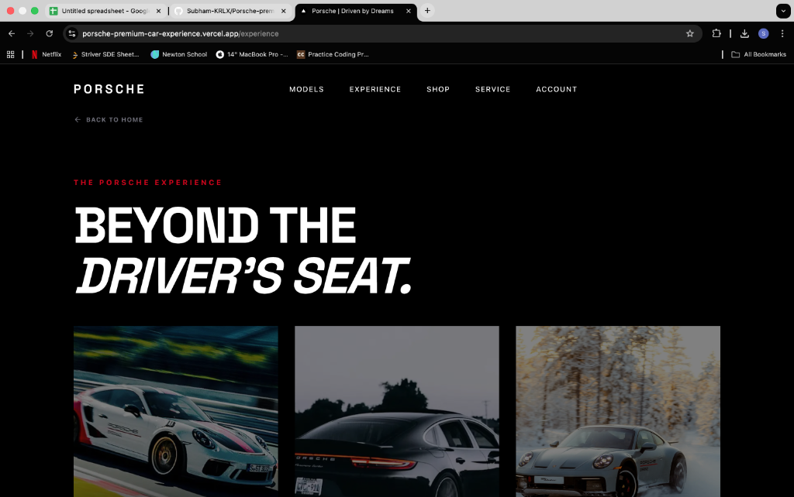
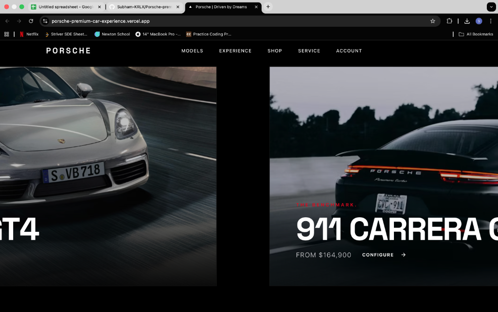
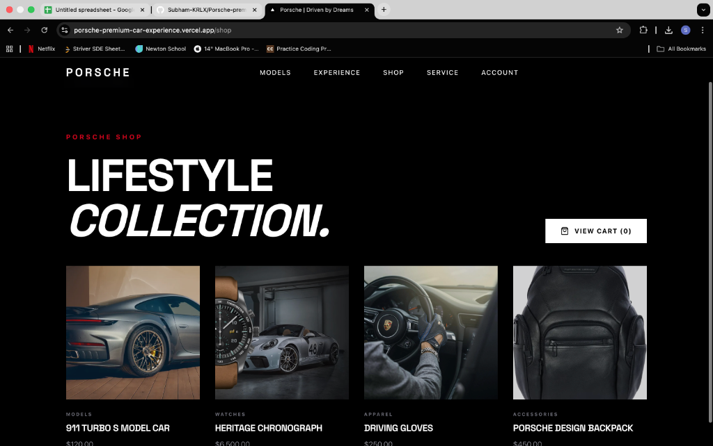
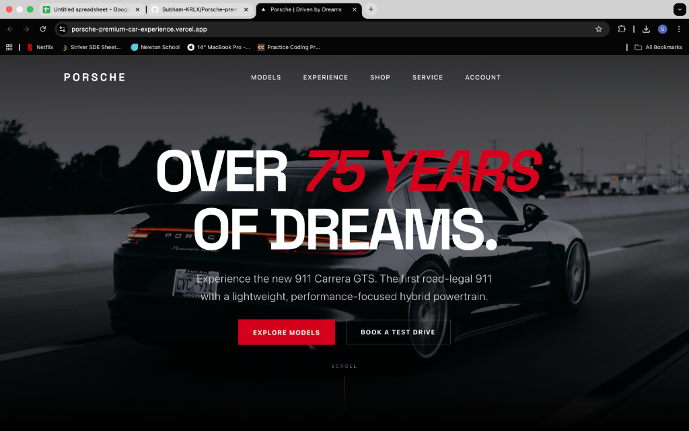

# Porsche Premium Car Experience
A premium digital experience showcasing luxury Porsche vehicles, built with modern web technologies to deliver a sleek, immersive, and high-performance user journey. This project captures the essence of the Porsche brand through fluid animations, model galleries, and a sophisticated design system.

This is an independent portfolio project, not an official Porsche service. The test-drive form is a client-side demonstration: it validates sample details but does not transmit or store them, contact a dealer, or create a booking.

## 📸 Project Showcase
### **The Pure Porsche Experience**
Experience the brand in its purest form with a cinematic landing page featuring car photography and dynamic typography.

### **Beyond The Driver’s Seat**
Explore the philosophy behind the engineering.


### **Lifestyle Collection**
A dedicated shop section showcasing the premium lifestyle accessories that accompany the drive.


### **75 Years of Dreams**
Celebrating the heritage and the future of the 911 Carrera GTS.


---

## 🛠 Tech Stack

This project uses a modern Next.js stack:

- **Framework**: [Next.js 15](https://nextjs.org/) (App Router)
- **Styling**: [Tailwind CSS v4](https://tailwindcss.com/)
- **Animations**:
  - [Framer Motion](https://www.framer.com/motion/) (UI Interactions)
  - [GSAP](https://gsap.com/) (Complex Sequences)
- **Smooth Scrolling**: [Lenis](https://github.com/darkroomengineering/lenis)
- **Icons**: [Lucide React](https://lucide.dev/)

The current application has no database, authentication, payment integration, or live booking backend. Account and shop content are demonstrations.

---

## 🚀 Getting Started

Follow these steps to run the project locally.

### Prerequisites

- Node.js 18.18 or newer
- npm

### Installation

1.  **Clone the repository:**
    ```bash
    git clone https://github.com/Subham-KRLX/Porsche-premium-car-experience.git
    cd Porsche-premium-car-experience
    ```

2.  **Install dependencies:**
    ```bash
    npm ci
    ```

    No environment variables or external service credentials are required by the current application.

3.  **Run the development server:**
    ```bash
    npm run dev
    ```

4.  **Open the app:**
    Visit [http://localhost:3000](http://localhost:3000) in your browser.

## 📦 Build & Deployment

Run the code checks before building:

```bash
npm run lint
npm run typecheck
npm test
```

To build the application for production:

```bash
npm run build
```

This application is optimized for deployment on **Vercel**.

1.  Push your code to GitHub.
2.  Import the project in Vercel.
3.  Deploy with the default Next.js build settings.

## 📄 License

This project is licensed under the MIT License.
